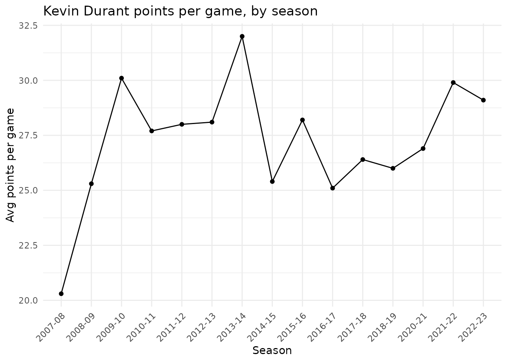

# Worked Example with draftstats

``` r

library(draftstats)
```

This example will follow the 2007 NBA draft where Greg Oden was the
first pick and Kevin Durant was the second. This will explore the data,
compare players to others drafted near them, and look at an individual
player’s performance across seasons.

## Data Exploration

`nba_draft` includes one row per drafted NBA player with their career
per-game statistics. (`wnba_draft` has the same structure but will not
be explored in this example.) Players who were drafted but have no
recorded games played have `NA` for their statistics.

``` r

head(nba_draft)
#>      player_name draft_year draft_number team_abbreviation    college   gp reb
#> 1 Pervis Ellison       1989            1               SAC Louisville  474 6.7
#> 2    Danny Ferry       1989            2               LAC       Duke  917 2.8
#> 3   Sean Elliott       1989            3               SAS    Arizona  742 4.3
#> 4      Glen Rice       1989            4               MIA   Michigan 1000 4.4
#> 5      J.R. Reid       1989            5               CHH        UNC  672 5.0
#> 6    Stacey King       1989            6               CHI   Oklahoma  438 3.3
#>    pts ast
#> 1  9.5 1.5
#> 2  7.0 1.3
#> 3 14.2 2.6
#> 4 18.3 2.1
#> 5  8.5 1.0
#> 6  6.4 0.9
dim(nba_draft)
#> [1] 1922    9
sum(is.na(nba_draft$pts)) # number of players who have no points recorded (i.e., drafted players who never played)
#> [1] 253

nba_draft[nba_draft$player_name %in% c("Greg Oden", "Kevin Durant"), ]
#>       player_name draft_year draft_number team_abbreviation    college  gp reb
#> 1023    Greg Oden       2007            1               POR Ohio State 105 6.2
#> 1024 Kevin Durant       2007            2               SEA      Texas 939 7.1
#>       pts ast
#> 1023  8.0 0.5
#> 1024 27.2 4.3
```

`nba_players` has one row per player per season, which is helpful to
track performance over time. Draft number will be `NA` for players who
were undrafted.

``` r

head(nba_players)
#>        player_name team_abbreviation age player_height player_weight
#> 1 Randy Livingston               HOU  22        193.04      94.80073
#> 2 Gaylon Nickerson               WAS  28        190.50      86.18248
#> 3     George Lynch               VAN  26        203.20     103.41898
#> 4   George McCloud               LAL  30        203.20     102.05820
#> 5     George Zidek               DEN  23        213.36     119.74829
#> 6   Gerald Wilkins               ORL  33        198.12     102.05820
#>                 college country draft_year draft_round draft_number gp  pts reb
#> 1       Louisiana State     USA       1996           2           42 64  3.9 1.5
#> 2 Northwestern Oklahoma     USA       1994           2           34  4  3.8 1.3
#> 3        North Carolina     USA       1993           1           12 41  8.3 6.4
#> 4         Florida State     USA       1989           1            7 64 10.2 2.8
#> 5                  UCLA     USA       1995           1           22 52  2.8 1.7
#> 6 Tennessee-Chattanooga     USA       1985           2           47 80 10.6 2.2
#>   ast net_rating oreb_pct dreb_pct usg_pct ts_pct ast_pct  season
#> 1 2.4        0.3    0.042    0.071   0.169  0.487   0.248 1996-97
#> 2 0.3        8.9    0.030    0.111   0.174  0.497   0.043 1996-97
#> 3 1.9       -8.2    0.106    0.185   0.175  0.512   0.125 1996-97
#> 4 1.7       -2.7    0.027    0.111   0.206  0.527   0.125 1996-97
#> 5 0.3      -14.1    0.102    0.169   0.195  0.500   0.064 1996-97
#> 6 2.2       -5.8    0.031    0.064   0.203  0.503   0.143 1996-97
dim(nba_players)
#> [1] 12844    21
sum(is.na(nba_players$draft_number)) # note: this value will consider each season an undrafted player played in
#> [1] 2417

nba_players[nba_players$player_name == "Kevin Durant", ]
#>        player_name team_abbreviation age player_height player_weight
#> 5209  Kevin Durant               SEA  19        205.74      97.52228
#> 5423  Kevin Durant               OKC  20        205.74      97.52228
#> 6184  Kevin Durant               OKC  21        205.74     104.32616
#> 6291  Kevin Durant               OKC  22        205.74     104.32616
#> 6787  Kevin Durant               OKC  23        205.74     106.59412
#> 7560  Kevin Durant               OKC  24        205.74     106.59412
#> 8014  Kevin Durant               OKC  25        205.74     108.86208
#> 8525  Kevin Durant               OKC  26        205.74     108.86208
#> 9015  Kevin Durant               OKC  27        205.74     108.86208
#> 9140  Kevin Durant               GSW  28        205.74     108.86208
#> 9629  Kevin Durant               GSW  29        205.74     108.86208
#> 10506 Kevin Durant               GSW  30        205.74     108.86208
#> 11569 Kevin Durant               BKN  32        208.28     108.86208
#> 12190 Kevin Durant               BKN  33        208.28     108.86208
#> 12664 Kevin Durant               PHX  34        208.28     108.86208
#>            college country draft_year draft_round draft_number gp  pts reb ast
#> 5209         Texas     USA       2007           1            2 80 20.3 4.4 2.4
#> 5423         Texas     USA       2007           1            2 74 25.3 6.5 2.8
#> 6184         Texas     USA       2007           1            2 82 30.1 7.6 2.8
#> 6291         Texas     USA       2007           1            2 78 27.7 6.8 2.7
#> 6787         Texas     USA       2007           1            2 66 28.0 8.0 3.5
#> 7560         Texas     USA       2007           1            2 81 28.1 7.9 4.6
#> 8014         Texas     USA       2007           1            2 81 32.0 7.4 5.5
#> 8525         Texas     USA       2007           1            2 27 25.4 6.6 4.1
#> 9015         Texas     USA       2007           1            2 72 28.2 8.2 5.0
#> 9140         Texas     USA       2007           1            2 62 25.1 8.3 4.8
#> 9629         Texas     USA       2007           1            2 68 26.4 6.8 5.4
#> 10506        Texas     USA       2007           1            2 78 26.0 6.4 5.9
#> 11569 Texas-Austin     USA       2007           1            2 35 26.9 7.1 5.6
#> 12190 Texas-Austin     USA       2007           1            2 55 29.9 7.4 6.4
#> 12664        Texas     USA       2007           1            2 47 29.1 6.7 5.0
#>       net_rating oreb_pct dreb_pct usg_pct ts_pct ast_pct  season
#> 5209       -11.7    0.027    0.111   0.278  0.519   0.120 2007-08
#> 5423        -9.5    0.030    0.166   0.282  0.577   0.135 2008-09
#> 6184         7.0    0.038    0.177   0.317  0.607   0.130 2009-10
#> 6291         4.7    0.023    0.174   0.302  0.589   0.127 2010-11
#> 6787         7.7    0.019    0.200   0.308  0.610   0.170 2011-12
#> 7560        12.7    0.018    0.201   0.298  0.647   0.213 2012-13
#> 8014         8.0    0.022    0.184   0.327  0.635   0.259 2013-14
#> 8525         7.2    0.020    0.181   0.285  0.633   0.213 2014-15
#> 9015        11.2    0.021    0.209   0.305  0.634   0.230 2015-16
#> 9140        16.0    0.023    0.232   0.276  0.651   0.218 2016-17
#> 9629         7.0    0.015    0.169   0.293  0.640   0.243 2017-18
#> 10506       11.4    0.013    0.153   0.283  0.631   0.251 2018-19
#> 11569       10.7    0.012    0.180   0.303  0.666   0.252 2020-21
#> 12190        6.5    0.015    0.166   0.310  0.634   0.274 2021-22
#> 12664        6.8    0.012    0.166   0.305  0.677   0.228 2022-23
nba_players[nba_players$player_name == "Greg Oden", ]
#>      player_name team_abbreviation age player_height player_weight    college
#> 5479   Greg Oden               POR  21        213.36      129.2737 Ohio State
#> 6008   Greg Oden               POR  22        213.36      129.2737 Ohio State
#> 7631   Greg Oden               MIA  26        213.36      123.8306 Ohio State
#>      country draft_year draft_round draft_number gp  pts reb ast net_rating
#> 5479     USA       2007           1            1 61  8.9 7.0 0.5        7.6
#> 6008     USA       2007           1            1 21 11.1 8.5 0.9        8.9
#> 7631     USA       2007           1            1 23  2.9 2.3 0.0       -7.5
#>      oreb_pct dreb_pct usg_pct ts_pct ast_pct  season
#> 5479    0.155    0.252   0.191  0.599   0.038 2008-09
#> 6008    0.161    0.267   0.209  0.647   0.066 2009-10
#> 7631    0.126    0.177   0.154  0.567   0.007 2013-14
```

## How did the top draft picks overall perform?

[`draft_rank_stats()`](https://b-rubinstein.github.io/draftstats/reference/draft_rank_stats.md)
is used to calculate the average and median values of a given measure
for all players drafted within a range of picks.
[`draft_rank_comps()`](https://b-rubinstein.github.io/draftstats/reference/draft_rank_comps.md)
then compares those values between two different draft ranges. Here, we
will look at points and rebounds per game for the top five picks and
compare them with picks six through ten.

``` r

draft_rank_stats(nba_draft, 1, 5, "pts")
#>   Num_Players Measure      Avg Median
#> 1         165     pts 14.27697   14.2
draft_rank_stats(nba_draft, 1, 5, "reb")
#>   Num_Players Measure      Avg Median
#> 1         165     reb 5.637576    5.1

draft_rank_comps(nba_draft, 1, 5, 6, 10, "pts")
#>   Range Measure      Avg Median Diff_Avg Diff_Median
#> 1   1-5     pts 14.27697   14.2 3.937576         4.8
#> 2  6-10     pts 10.33939    9.4 3.937576         4.8
draft_rank_comps(nba_draft, 1, 5, 6, 10, "reb")
#>   Range Measure      Avg Median Diff_Avg Diff_Median
#> 1   1-5     reb 5.637576    5.1 1.327273           1
#> 2  6-10     reb 4.310303    4.1 1.327273           1
```

Picks 1-5 had 3.9 more points and 1.3 more rebounds on average than
picks 6-10.

## Comparing Oden and Durant to those drafted in similar positions

[`player_picks_comps()`](https://b-rubinstein.github.io/draftstats/reference/player_picks_comps.md)
compares a player’s average on a given measure to the average and median
of those drafted within a window of picks around them, across every
draft in the dataset. We will compare Oden and Durant’s points and
rebounds per game to players picked within three spots of them.

``` r


player_picks_comps(nba_draft, "Greg Oden", "pts", 3)
#>      Player Range Measure Player_stat     Avg Median  Diff_Avg Diff_Median
#> 1 Greg Oden   1-4     pts           8 14.7197  14.65 -6.719697       -6.65
player_picks_comps(nba_draft, "Greg Oden", "reb", 3)
#>      Player Range Measure Player_stat      Avg Median Diff_Avg Diff_Median
#> 1 Greg Oden   1-4     reb         6.2 5.880303   5.55 0.319697        0.65

player_picks_comps(nba_draft, "Kevin Durant", "pts", 3)
#>         Player Range Measure Player_stat      Avg Median Diff_Avg Diff_Median
#> 1 Kevin Durant   1-5     pts        27.2 14.27697   14.2 12.92303          13
player_picks_comps(nba_draft, "Kevin Durant", "reb", 3)
#>         Player Range Measure Player_stat      Avg Median Diff_Avg Diff_Median
#> 1 Kevin Durant   1-5     reb         7.1 5.637576    5.1 1.462424           2
```

Oden scored 6.7 points below the average of players picked in spots 1-4,
but his rebounding was right around the average. Durant scored 13 points
above the average of players picked in spots 1-5, and had about 1.5 more
rebounds.

## Durant’s trajectory across seasons

[`player_year_comps()`](https://b-rubinstein.github.io/draftstats/reference/player_year_comps.md)
compares a player between two seasons. In the following example, we will
follow Kevin Durant from his rookie season (2007-08) through 2022-23,
his 16th active season. Note, there is no data from the 2019-20 season
as Durant was recovering from an Achilles injury.

``` r


seasons <- nba_players$season[nba_players$player_name == "Kevin Durant"]
seasons <- seasons[-1]

durant <- data.frame()

for (s in seasons) {
  stats <- player_year_comps(nba_players, "Kevin Durant", "2007-08", s, "pts")
  durant <- rbind(durant, stats)
}

durant$Season <- seasons
durant
#>          Player Draft_Year             Seasons Measure Season1_value
#> 1  Kevin Durant       2007 2007-08 vs. 2008-09     pts          20.3
#> 2  Kevin Durant       2007 2007-08 vs. 2009-10     pts          20.3
#> 3  Kevin Durant       2007 2007-08 vs. 2010-11     pts          20.3
#> 4  Kevin Durant       2007 2007-08 vs. 2011-12     pts          20.3
#> 5  Kevin Durant       2007 2007-08 vs. 2012-13     pts          20.3
#> 6  Kevin Durant       2007 2007-08 vs. 2013-14     pts          20.3
#> 7  Kevin Durant       2007 2007-08 vs. 2014-15     pts          20.3
#> 8  Kevin Durant       2007 2007-08 vs. 2015-16     pts          20.3
#> 9  Kevin Durant       2007 2007-08 vs. 2016-17     pts          20.3
#> 10 Kevin Durant       2007 2007-08 vs. 2017-18     pts          20.3
#> 11 Kevin Durant       2007 2007-08 vs. 2018-19     pts          20.3
#> 12 Kevin Durant       2007 2007-08 vs. 2020-21     pts          20.3
#> 13 Kevin Durant       2007 2007-08 vs. 2021-22     pts          20.3
#> 14 Kevin Durant       2007 2007-08 vs. 2022-23     pts          20.3
#>    Season2_value Difference  Season
#> 1           25.3        5.0 2008-09
#> 2           30.1        9.8 2009-10
#> 3           27.7        7.4 2010-11
#> 4           28.0        7.7 2011-12
#> 5           28.1        7.8 2012-13
#> 6           32.0       11.7 2013-14
#> 7           25.4        5.1 2014-15
#> 8           28.2        7.9 2015-16
#> 9           25.1        4.8 2016-17
#> 10          26.4        6.1 2017-18
#> 11          26.0        5.7 2018-19
#> 12          26.9        6.6 2020-21
#> 13          29.9        9.6 2021-22
#> 14          29.1        8.8 2022-23
```

Throughout every season, Durant performed better in terms of points
scored than his rookie season. His highest average points per season was
in the 2013-14 season, with 32 points per game.

``` r

library(ggplot2)

rookie_season <- data.frame(Season = "2007-08", Season2_value = durant$Season1_value[1])
durant <- rbind(rookie_season, durant[, c("Season", "Season2_value")])

ggplot(durant, aes(x=Season, y=Season2_value, group =1))+
  geom_line()+
  geom_point()+
  labs(title = "Kevin Durant points per game, by season",
       x = "Season",
       y= "Avg points per game")+ 
  theme_minimal()+
  theme(axis.text.x = element_text(angle = 45, hjust =1))
```


